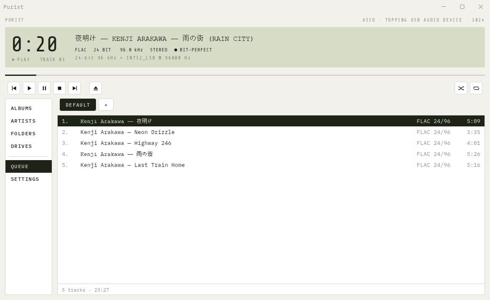
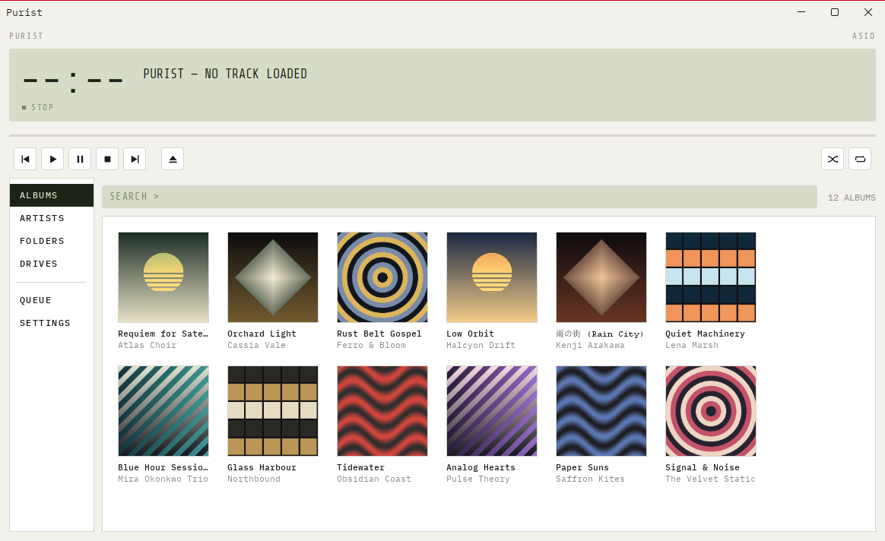
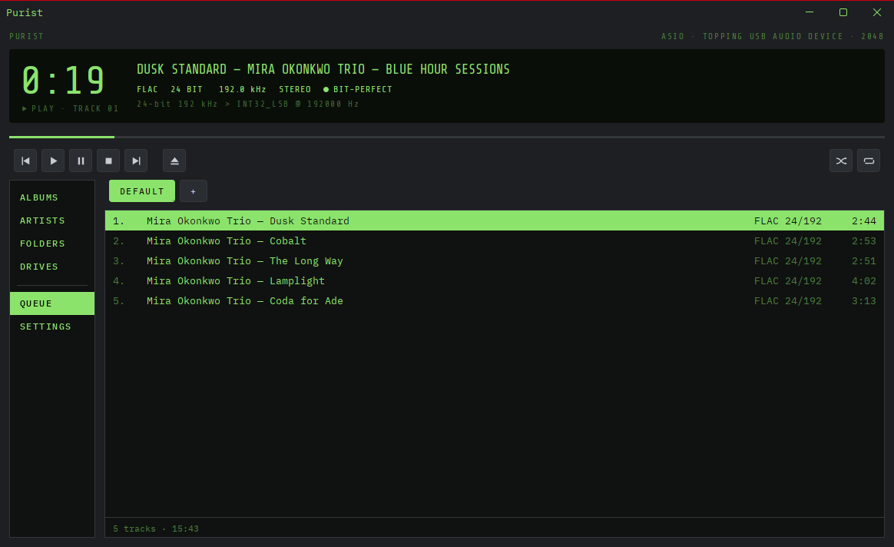
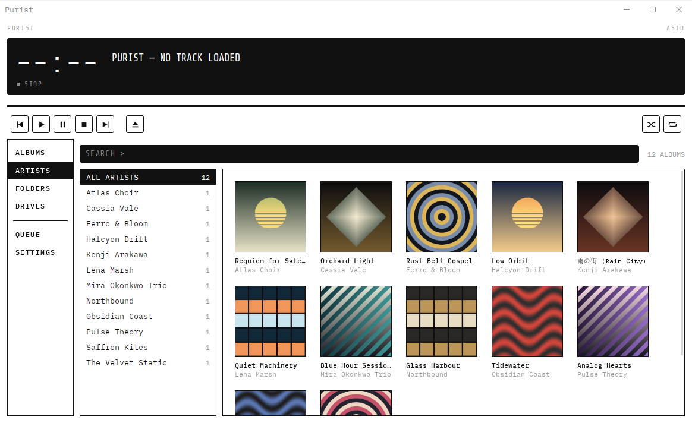
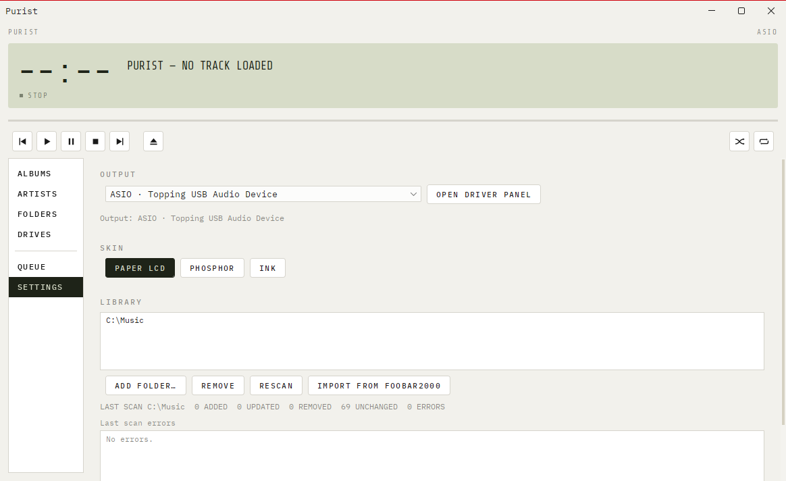

<h1 align="center">Purist</h1>

<p align="center">
  <b>A bit-perfect music player for Windows that talks straight to your DAC.</b><br>
  No resampling, no dither, no volume, no DSP: the samples in the file are the samples the DAC gets, or the track is refused with the reason.
</p>

<p align="center">
  
  
  
  
  
</p>

<p align="center">
  
</p>

---

## Why

Most players hand audio to the Windows mixer, which can quietly resample, mix and apply volume. Purist owns the
device instead (ASIO, or WASAPI in exclusive mode) and checks the whole path for every track. The deck shows that
path: the file's format, what the device was opened at, and a **● BIT-PERFECT** mark only when nothing in between
touches a sample.

```
24-bit 96 kHz  >  INT32_LSB @ 96000 Hz        ● BIT-PERFECT
```

If the device can't take a file exactly as it is (an unsupported rate, say), Purist doesn't convert it. It skips
the track and tells you why.

## Features

- **Bit-perfect or refuse.** No resampling, dither, gain, EQ, float conversion or fades, ever.
- **Formats:** FLAC (own decoder, checked against the STREAMINFO MD5), WAV / RF64, AIFF / AIFC, DSF, DFF, and
  SACD ISO (stereo DSD).
- **Any DAC:**
  - **ASIO** with any installed driver: PCM, plus native DSD64/128 where the driver and DAC support it.
  - **WASAPI exclusive** for class-compliant DACs: PCM untouched, and DSD as DoP v1.1 when you turn it on.
- **Gapless** playback within a format, with a clean reopen when the rate changes between albums.
- **Library:**
  - Watched folders that update live.
  - Whole-drive discovery through [Everything](https://www.voidtools.com/) when it's running, with a folder-walk
    fallback otherwise.
  - Album grid with cover art, Artists and Folders views.
  - foobar-style search: `artist:jackson`, `year:1982`, `format:dsd`, `"exact phrase"`.
- **Playlists:** tabs, drag to reorder, and a read-only one-time import from foobar2000.
- **Three skins:** Paper LCD, Phosphor and Ink, inspired by classic hardware decks.
- **Device handling:** if the DAC is switched off or unplugged, a banner appears, Purist retries, and playback
  resumes when the DAC comes back.

## Screenshots

| Albums, Paper LCD | Now playing, Phosphor |
|---|---|
|  |  |
| **Artists, Ink** | **Settings** |
|  |  |

<sub>The library in these screenshots is invented: silent FLACs with made-up names and generated covers.</sub>

## Install

Download `Purist-<version>.msi` from [Releases](../../releases) and run it.

- It installs per user, with no admin prompt, into `%LOCALAPPDATA%\Programs\Purist`, and adds a Start-menu
  shortcut.
- It adds an **Open with → Purist** entry for `.flac`, `.wav`, `.aif(f/c)`, `.dsf`, `.dff` and `.iso` files, but
  never takes over a default app: `.iso` still mounts as a disc image.
- It bundles its own Java runtime, so there's nothing else to install.
- Upgrades keep your settings and library. Uninstalling leaves your data in `%USERPROFILE%\.purist`.

## Build from source

Requirements: JDK 25, Maven 3.9+, and for the installer, [WiX 7](https://wixtoolset.org/) as a .NET tool.

```powershell
mvn package               # target\purist-0.1.0-SNAPSHOT.jar plus target\lib\
.\run.cmd                 # run it
.\scripts\package.ps1     # target\dist\Purist-0.1.0.msi (jpackage app image + WiX)
```

Purist keeps its settings and library database in `%USERPROFILE%\.purist`. Pass `-Dpurist.profile=<dir>` to use
another folder.

## How it works

- **Pure Java 25.** Every native call, including COM, the ASIO vtable, WASAPI, kernel32 and the Everything SDK, goes
  through the Foreign Function & Memory API. There's no JNI and no native helper DLL.
- **Real-time path:** decoders fill a single-producer/single-consumer ring buffer, and the device callback copies
  from it without allocating or taking a lock.
- **ASIO:** Purist validates the channel type the driver actually reports after `kAsioSetIoFormat`, not the driver's
  claims. Some drivers say they accept DSD on hardware that has none.
- **WASAPI exclusive:** event-driven. The container is chosen in strict order: exact bits, then 24-in-32, then 32.
  A 32-bit file is never truncated to fit.
- **Library:** SQLite, with each file stamped by size and modified time. A row is deleted only when the file is
  confirmed gone. Only content faults mark a file broken; access errors are retried. Cloud-only OneDrive files are
  never opened, so they're never downloaded.

## Tests

`mvn test` runs the default suite: 1,200+ tests covering the decoders, packers, ring buffer, ASIO and WASAPI logic
against fakes, the library, and the UI models. Groups that need real hardware or files are excluded by default:

| Tag        | Needs                                                                        |
|------------|------------------------------------------------------------------------------|
| `hardware` | an ASIO device and a WASAPI endpoint (the ITs use a UA Volt 176)              |
| `topping`  | a Topping D50: PCM up to 192 kHz and native DSD64/128, checked bit-perfect    |
| `library`  | real music files, read-only; paths come from `-Dpurist.libraryRoots`, `-Dpurist.sacdIso` and `-Dpurist.dsfAlbum` |

```powershell
mvn test "-Dtest.excluded=" -Dgroups=topping
```

## Licence

Copyright (C) 2026 Purist contributors.

Purist is free software, released under the GNU General Public License, version 3 or (at your option) any later
version. See [LICENSE](LICENSE). The ASIO interface layout is reproduced in Java only; no Steinberg SDK files are
included.
